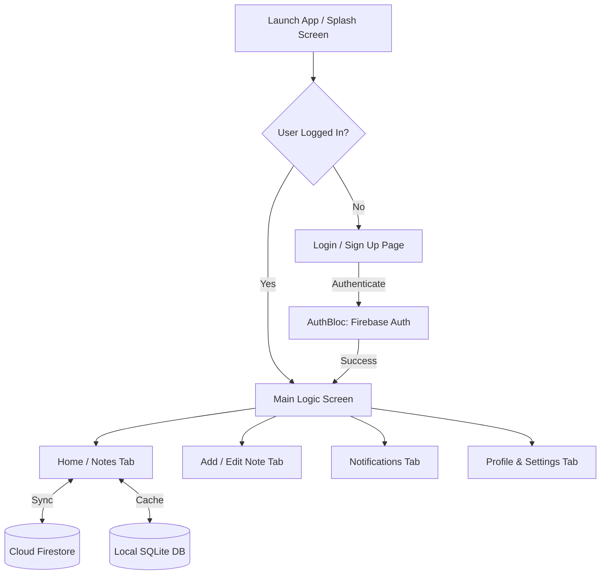

# Note App (note_app_ikokas)

A modern, production-ready Flutter note-taking application built with **BLoC pattern**, **Firebase services**, and **offline SQLite caching**.

---

## 📌 Overview

The application enables users to seamlessly create, edit, view, and organize notes. It is designed to work smoothly both online and offline by synchronizing data between **Cloud Firestore** and a local **SQLite** database.

---

## 🚀 Key Features

- **Multi-Provider Authentication**:
  - Email & Password login / registration.
  - Google Sign-In (via `google_sign_in`).
  - Microsoft Sign-In (via Firebase `OAuthProvider`).
  - *(Facebook Login is implemented and currently commented out/disabled)*.
- **Offline-First Note Management**:
  - Full CRUD operations (Create, Read, Update, Delete) for notes.
  - Cloud Firestore as the primary real-time database.
  - Local caching via SQLite (`sqflite`), enabling full offline reading and writing capability.
- **Dynamic Theming**:
  - Supports Light Mode and Dark Mode.
  - User theme preference is saved and retrieved from local storage.
- **Push & Local Notifications**:
  - Remote notifications via **Firebase Cloud Messaging (FCM)**.
  - Foreground and system alerts using **Flutter Local Notifications** (`flutter_local_notifications`).
  - In-app notification center/tab to view notification history.
- **Monitoring & Observability**:
  - **Firebase Analytics**: Tracks key user actions (e.g. login method, user events).
  - **Firebase Crashlytics**: Captures caught exceptions and unhandled crashes for debugging.

---

## 🛠️ Architecture & State Management

The application adheres to the **BLoC (Business Logic Component)** pattern for clean separation of concerns:

| BLoC | Responsibility |
| :--- | :--- |
| **`AuthBloc`** | Handles user authentication state (`Authenticated`, `Unauthenticated`, `AuthLoading`, `AuthError`), login, sign-up, Google Sign-In, Microsoft Sign-In, and logout. |
| **`NotesBloc`** | Manages note operations (fetching, adding, editing, deleting) and coordinates syncing between Cloud Firestore and SQLite. |
| **`ThemeBloc`** | Controls app theme state (Light / Dark mode) and persists preferences locally. |
| **`NotificationBloc`** | Listens for FCM push notifications, stores notification logs, and displays notifications locally. |

---

## 🗄️ Tech Stack & Packages

- **Framework**: [Flutter](https://flutter.dev/)
- **State Management**: `flutter_bloc`
- **Backend & Cloud Services**:
  - `firebase_core`
  - `firebase_auth`
  - `cloud_firestore`
  - `firebase_messaging` (FCM)
  - `firebase_analytics`
  - `firebase_crashlytics`
- **Authentication Providers**:
  - `google_sign_in`
  - `flutter_facebook_auth` *(commented out)*
- **Local Storage**:
  - `sqflite` & `path`
- **Notifications**:
  - `flutter_local_notifications`

---

## 🔄 Application Workflow



1. **App Initialization**:
   - `main.dart` initializes Firebase Core, Crashlytics error handlers, FCM background messaging, and local database services.
   - The app checks for stored theme preferences and user session.
2. **Authentication Flow**:
   - Users can log in using Email/Password, Google, or Microsoft.
   - On successful authentication, user details are synchronized to Firestore and cached in SQLite.
3. **Notes Sync Flow**:
   - When notes are created or updated, changes are dispatched through `NotesBloc`.
   - The data is written to Cloud Firestore and simultaneously saved in local SQLite tables for immediate offline availability.
4. **Notification Flow**:
   - FCM triggers on incoming messages (foreground, background, or terminated).
   - Foreground messages are converted into local system notifications via `flutter_local_notifications` and recorded in the in-app notification list.
5. **Stability & Analytics**:
   - Authentication events are recorded to Firebase Analytics.
   - Uncaught exceptions and caught try-catch errors are logged to Firebase Crashlytics.

---

## 📱 Project Structure

```
lib/
├── bloc/
│   ├── auth_bloc/         # Authentication events, states, and logic
│   ├── notes_bloc/        # Notes CRUD events, states, and logic
│   ├── notification_bloc/ # FCM & local notification management
│   └── theme_bloc/        # Theme toggling & persistence
├── core/
│   ├── auth_repo.dart     # Firebase Auth, Google, Microsoft repositories
│   └── fcm_service.dart   # FCM configuration and notification handlers
├── dbhelper/              # SQLite helper classes for notes, users, and themes
├── model/                 # Data models (UserModel, NoteModel, NotificationModel)
├── pages/
│   ├── homepage.dart      # Notes list and main UI
│   ├── login_page.dart    # Login interface
│   ├── signup_page.dart   # Sign-up interface
│   ├── splash_screen.dart # Splash screen
│   └── tabs/              # Bottom navigation tabs (edit, notifications, profile)
├── widgets/               # Reusable UI components (bottom nav bar, custom widgets)
└── main.dart              # App entry point and provider setup
```
